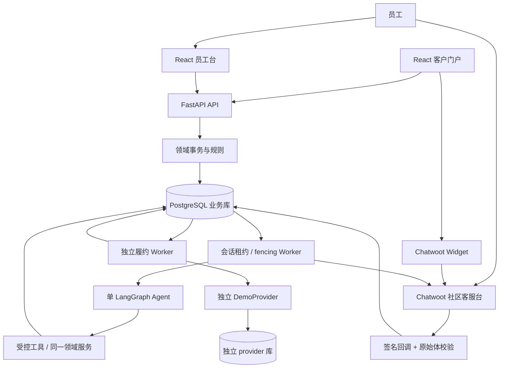

# 架构与权威边界

采用一个 Python `src/aftersales` 包和一个 React 工程。与 SPEC 示例 `backend/app/...` 路径相比仅合并了源码目录；领域、API、适配器、任务边界保留。API 容器同源提供构建后的 React 静态资源，减少本地部署服务；Chatwoot 的 Rails、Sidekiq、Redis 和数据库仍独立。Redis 只用于 Chatwoot，业务任务用 PostgreSQL。

`after_sales_cases`、设备金额分摊、库存/金额预留和 operation 是权威事实，模型摘要与 LangGraph checkpoints 都不能改变它们。客户确认、员工寄回初审、收货验收由独立权限接口执行。政策以不可变版本发布，订单绑定购买版本，已受理窗口以 accepted_at 固定。

会话任务用独立租约、输入/控制版本和 fencing 串行领取。启动、工具副作用、生成发送意图和发送前均重新验证本地授权；发送前还读真实 Chatwoot。人工接管先提交本地暂停、撤销未确认 Agent 草稿，再同步远端。只有员工显式交回能恢复。跨系统 GET 与 POST 没有共同事务，不能承诺消除最后一个网络竞态。

消息先持久化 outbox；未知发送结果不重发，需员工按远端 message ID 或明确未送达证据核对，再显式交回。退款/出库 worker 与会话 worker 分开；接管聊天不会取消已授权履约。每个履约义务固定供应商、模式、环境和不可变请求，UNKNOWN 保留资源并查询同一个 key，不更换 key 盲重试。

Chatwoot、业务和模拟履约分别使用不同数据库用户；业务代码不写 Chatwoot Rails 表。LangGraph 官方 PostgresSaver 自建检查点迁移位于独立 schema，业务 Alembic 不仿造检查点表。DemoProvider 也使用独立 Alembic 迁移与环境标记。

## 有限运行预算的实施选择

SPEC第9节建议首版6次模型/8次工具，保留原文。实际顺序工具链最多8次工具后仍需最终答复，因此当前配置为9次模型/8次工具；总轮次120秒，供应商HTTP60秒。原6/30秒配置的完整与中断结果全部保留。此调整在新v2保留集第一次调用前完成，提示词、评分与业务资格门槛未改；freeze-v2同时固定实际预算，后续变动会拒绝复用。
